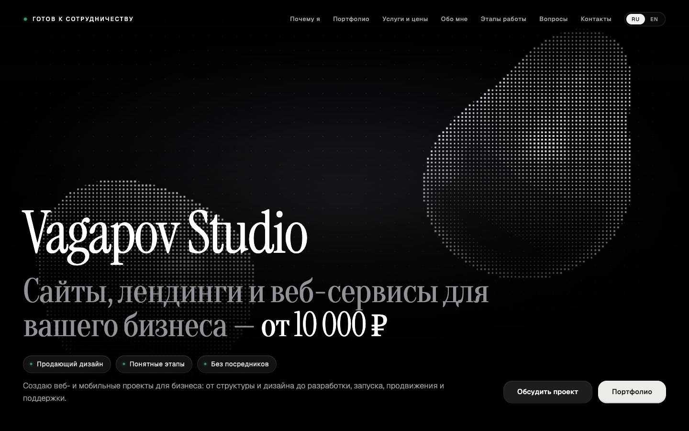

# Vagapov Studio

**Сайт студии дизайна и разработки**

[Открыть сайт](https://vagapov-studio.netlify.app/)

## Задача

Показать подход к разработке и дать посетителю возможность изучить проекты, попробовать интерфейсы и обсудить свою задачу.

## Возможности

- Портфолио с описанием задач, возможностей и статуса каждого проекта.
- Интерактивный предпросмотр сайтов и кабинета владельца «Брауни».
- Адаптивные окна проектов с фиксированными действиями и отдельным блоком информации.
- Форматы работы, ориентиры стоимости и этапы разработки.
- Интерактивный WebGL-фон и подсветка элементов рядом с указателем.
- Русская и английская версии, контакты и форма обсуждения задачи.

## Реализация

HTML, CSS, JavaScript и Three.js / WebGL. Публикация на Netlify; интерфейс адаптирован для компьютеров и телефонов.

Проектирование сценариев, дизайн интерфейса, адаптация и разработка — Vagapov Studio.

## Статус

Опубликованный сайт студии. Внутри портфолио размещены демонстрационные проекты; их готовность к рабочему запуску описана в отдельных кейсах.

## Связаться

[Обсудить проект в Telegram](https://t.me/vagapov_studio) · [Написать на почту](mailto:vagapov.studio.pro@gmail.com) · [Сайт студии](https://vagapov-studio.netlify.app/)

---

Публичный кейс: описание, изображения и ссылки на демонстрацию. Исходный код проекта закрыт.
